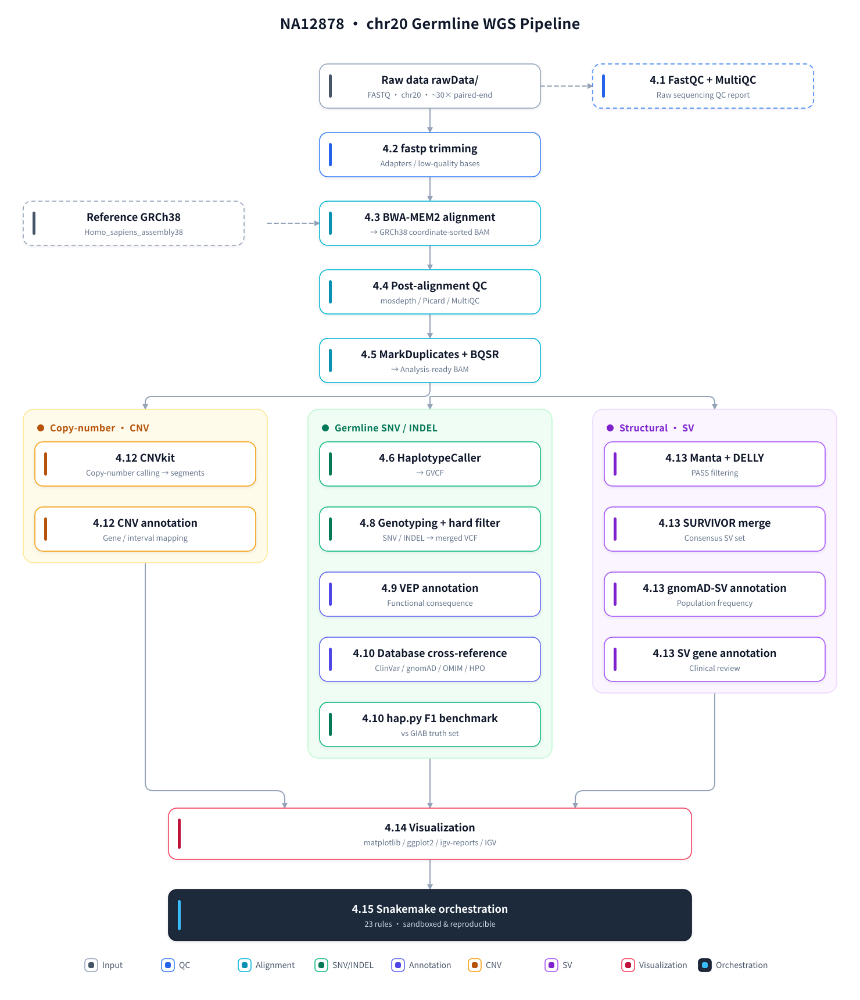

# WGS Germline Variant Calling — Hands-on Pipeline & Tutorial

   <br>
   

[English](README.md) | [简体中文](README_CN.md)

A complete, reproducible **germline whole-genome sequencing (WGS) pipeline**, built while working
through the [Multiome Academy WGS Series](https://multiomeacademy.com/tutorials/WGS/index.html)
(Sessions 01–20). Everything is demonstrated end-to-end on **NA12878 (HG001) chromosome 20**
against **GRCh38**, from raw FASTQ to annotated variants, CNVs, SVs and publication-quality figures.

---

## Highlights

| | |
|---|---|
| **Sample** | NA12878 / HG001 (NIST GIAB reference material) |
| **Region** | chr20 (64,444,167 bp), ~30× paired-end |
| **Reference** | GRCh38 (`Homo_sapiens_assembly38`) |
| **Steps** | 13 pipeline stages, 19 scripts, **23 Snakemake rules** |
| **Tutorial** | 6,196 lines, 15 sections (4.1–4.15), fully in Chinese |
| **Pitfalls** | Common failure modes, documented per step |
| **Reproducibility** | Sandboxed Snakemake run verified **identical** to the manual pipeline |

---

## Key Results

### Alignment & QC

| Metric | Value |
|---|---|
| Total reads | 17,037,573 |
| Mapped | 17,032,626 (**99.97%**) |
| Properly paired | 16,908,078 (99.45%) |
| Duplication rate | 9.85% |
| Mean depth on chr20 | **35.25×** (median ~32×) |

### Variant calling (HaplotypeCaller + hard filtering)

| Metric | Value |
|---|---|
| **PASS variants** | **124,135** |
| SNVs | 103,044 |
| INDELs | 21,091 |
| **Ts/Tv ratio** | **1.875** |
| Heterozygous / homozygous | 86,760 / 35,630 |

### Benchmark against the NIST GIAB truth set (hap.py)

| Type | Filter | Precision | Recall | **F1** |
|---|---|---|---|---|
| SNP | PASS | 0.9958 | 0.9768 | **0.9862** |
| SNP | ALL | 0.9907 | 0.9864 | 0.9886 |
| INDEL | PASS | 0.9941 | 0.9825 | **0.9883** |
| INDEL | ALL | 0.9936 | 0.9826 | 0.9881 |

### Structural & copy-number variation

| Metric | Value |
|---|---|
| CNV calls | **1** — `chr20:26,450,000–29,950,000`, 3.5 Mb **DUP**, log2 = +0.414 |
| Manta PASS / DELLY PASS | 192 / 237 |
| SURVIVOR consensus | **59** (55 DEL, 3 DUP, 1 INS) |
| Known / novel (vs gnomAD-SV v4.1) | 58 / 1 |
| Multi-gate clinical candidates | **43** genes |

---

## Pipeline Overview



---

## Repository Layout

```
.
├── WGS_tutorial.md        ⭐ Main tutorial (Chinese) — 15 sections, 6,196 lines
├── SKILL.md                  Reusable "Snakemake sandbox pipeline" skill
├── pipeline_overview_zh.svg  Pipeline overview figure (Chinese)
├── pipeline_overview_en.svg  Pipeline overview figure (English, referenced above)
│
├── scripts/               ⭐ All scripts
│   ├── 01–12.run_*.sh        Pipeline steps (19 scripts)
│   ├── 13.config.yaml        Central config (sample / tools / resources / params)
│   ├── 13.snakefile          Snakemake pipeline (23 rules)
│   ├── 13.run_snakemake.sh   Launcher (path validation / dry-run / run / DAG)
│   ├── 13.verify.sh          Sandbox verification + leak detection
│   ├── make_pipeline_overview.py   Regenerate the pipeline overview figures above
│   └── build_git_mirror.sh   Builds this placeholder repository
│
├── 01.qc/ … 12.figures/   Pipeline outputs (per-step directories)
│   └── 12.figures/           ⭐ All publication figures (PNG + PDF + IGV screenshots)
│
├── 13.snakemake/          Sandboxed re-run of the whole pipeline (isolated from 01–12)
│
└── rawData/               Read-only inputs (reference, GATK bundles, databases, VEP cache)
```

### ⚠️ About this repository — placeholder convention

This repository is a **lightweight mirror**: the full working project is **89 GB**, which is not
suitable for Git. Here, the complete directory structure is preserved, but only **96 files are real
copies**; the remaining **14,687 are zero-byte placeholders** (created with `touch`) that keep the
directory layout and file names intact.

**Three directories are excluded entirely**, because they carry no reusable information:
`logs/` (run logs), `backups/` (document snapshots), `.snakemake/` (Snakemake runtime state,
which embeds machine-specific absolute paths).

**Real file contents included:**

| Category | Files | What |
|---|---|---|
| Documents | 2 | `WGS_tutorial.md`, `SKILL.md` |
| Scripts | 41 | **Every script** — pipeline, orchestration, data prep, helpers |
| Figures | 16 | 7 figures × (PNG + PDF) + 2 self-contained igv-reports HTML |
| IGV screenshots | 4 | Manually annotated screenshots |
| Core results | 30 | Key result tables + core variant datasets (see below) |

**Core result files included:** hap.py benchmark summary, final CNV calls, SV clinical review,
43-candidate gene table, gnomAD frequency tiers, ClinVar classification, alignment/duplication/
depth/insert-size metrics, plus the final `filtered.vcf.gz` (124,135 variants), the VEP-annotated
VCF, and the SV consensus VCF.

**Purpose of those 30 files:** the tutorial embeds 14 figures inline. Two of them
(`04.post_alignment_qc/picard/..._insert_size_histogram_fixed.png` and
`13.snakemake/rulegraph.png`) live outside `12.figures/` — omitting them would leave broken
images in the rendered tutorial.

**Largest file:** 21.7 MB (`12.figures/NA12878_variant_report.html`) — well under GitHub's 50 MB
warning threshold.

---

## Documentation

| File | Language | Contents |
|---|---|---|
| **`WGS_tutorial.md`** | Chinese | The main work. 15 sections covering concepts, method, results and pitfalls for every pipeline stage — with embedded figures, command references, parameter explanations and measured numbers. |
| **`SKILL.md`** | Chinese | A reusable procedure for wrapping an existing script pipeline in a **sandboxed Snakemake DAG** — including the 10 most common failure modes. |

### Tutorial sections

| § | Step | Session | Topic |
|---|---|---|---|
| 1 | — | 01–03 | Introduction; what WGS is; scope and capability boundaries |
| 2 | 00 | 02–07 | Data download, environment, reference genome, GATK bundles |
| 3 | — | 04 | FASTQ format and quality |
| **4.1** | 01 | 05 | FastQC + MultiQC |
| **4.2** | 02 | 06 | fastp trimming + before/after comparison |
| **4.3** | 03 | 08 | BWA-MEM2 alignment |
| **4.4** | 04 | 09 | Post-alignment QC (mosdepth / Picard / MultiQC) |
| **4.5** | 05 | 10 | MarkDuplicates + BQSR |
| **4.6** | 06 | 11 | HaplotypeCaller |
| **4.7** | — | 12 | Joint Genotyping *(theory — trio data unavailable)* |
| **4.8** | 07 | 13 | Variant filtering & PASS rate |
| **4.9** | 08 | 14 | VEP annotation |
| **4.10** | 09 | 15 | Variant database cross-reference (ClinVar / gnomAD / OMIM / HPO) |
| **4.11** | — | 16 | Mutect2 somatic calling *(theory — no tumor/normal pair)* |
| **4.12** | 10 | 17 | CNV detection (CNVkit) |
| **4.13** | 11 | 18 | Structural variant detection (Manta + DELLY + SURVIVOR) |
| **4.14** | 12 | 19 | Visualization (matplotlib / ggplot2 / igv-reports / IGV) |
| **4.15** | 13 | 20 | **Snakemake orchestration** |

---

## Reproducibility

The whole pipeline is orchestrated with Snakemake and reproduces the manual results exactly
(verified by md5 / content comparison of every output).

```bash
# 1. Validate every path referenced in the config (no writes)
bash scripts/13.run_snakemake.sh

# 2. Execute the full pipeline (23 rules, resumable, parallel)
bash scripts/13.run_snakemake.sh --run

# 3. Generate the DAG diagrams
bash scripts/13.run_snakemake.sh --dag

# 4. Verify products against the original run + leak detection
bash scripts/13.verify.sh full          # quick | full
```

### Sandbox design

All pipeline products are written to `13.snakemake/` (configurable via `config.out_root`,
`--out DIR`, or the `WGS_OUT_ROOT` environment variable — **CLI > env > config**).
**The original `01.qc/`–`12.figures/` outputs and the manual IGV screenshots are never touched**,
so re-runs stay comparable side by side.

### Sample parameterization

The sample name is fully config-driven — changing it requires no script edits:

```yaml
# scripts/13.config.yaml
sample:        "NA12878_chr20"    # main prefix (steps 01–09)
sample_short:  "NA12878"          # short prefix (CNV / SV / figure outputs)
sample_label:  "NA12878 chr20"    # display text for figure titles
rg_flowcell:   "HMVFKDRXX.2"      # sequencing flowcell.lane (Read Group ID suffix)
rg_pu:         "HMVFKDRXX.2.ACGTACGT"
```

The Snakefile exports these to every step script, which read them as
`SAMPLE="${SAMPLE:-NA12878_chr20}"` — so **defaults reproduce the original behavior exactly**.

---

## Scope & Limitations

This is **not** a general-purpose WGS platform. It targets one well-defined analysis:

```
NA12878 (HG001) × chr20 × ~30× paired-end × germline variants
```

| Supported | Not supported |
|---|---|
| chr20 germline WGS (SNV / INDEL / CNV / SV / annotation / visualization) | **Switching chromosomes** — needs ~30 code changes + re-downloading gnomAD AF (~11.8 GB per chromosome) |
| **Changing the sample name** (5 config keys + new FASTQ) | Whole-genome variant calling (`-L chr20` restricts calling) |
| One-command resumable runs | Joint genotyping / trio analysis (no trio data) |
| Sandbox isolation + automatic comparison with the original results | Somatic calling with Mutect2 (no tumor/normal pair) |
| | F1 benchmarking after a sample swap — the GIAB truth set **is** HG001 |

> ⚠️ **Note on sample swapping:** `09.run_happy_benchmark.sh` benchmarks against the HG001 truth
> set — i.e. NA12878 itself. After changing the sample, that step will report a very low F1.
> That is expected: the truth set belongs to a different sample. Replace it or skip the step.

---

## Requirements

- **Linux** with a shared filesystem; ≥ 48 cores recommended for reasonable runtimes
- Conda environments for isolated toolchains (the config uses absolute paths throughout, so
  `conda activate` is never required)
- ~90 GB disk for the full project (reference, indexes, databases, VEP cache, outputs)
- Tools: FastQC, MultiQC, fastp, BWA-MEM2, samtools, mosdepth, GATK 4.6, VEP 105, SnpEff,
  hap.py, CNVkit, Manta, DELLY, SURVIVOR, Snakemake, matplotlib, R/ggplot2, igv-reports

> Large downloads (reference genome, GATK resource bundles, VEP cache, gnomAD) are **not**
> triggered by the Snakemake pipeline — it assumes they already exist under `rawData/`.
> The data-preparation scripts (`scripts/download_*.sh`, `extract_chr20_fastq.sh`,
> `build_bwa_mem2_index.sh`) cover the 00-step setup.

---

## Credits & Data Sources

| Resource | Source |
|---|---|
| Tutorial structure | [Multiome Academy WGS Series](https://multiomeacademy.com/tutorials/WGS/index.html) (Sessions 01–20) |
| Sample | NA12878 / HG001 — NIST GIAB, via NYGC / 1000 Genomes |
| Reference | GRCh38 (`Homo_sapiens_assembly38`, Broad Institute) |
| Truth set | NIST GIAB HG001 v4.2.1 |
| Variant databases | ClinVar (NCBI), gnomAD v4.1, DGV, OMIM, HPO |
