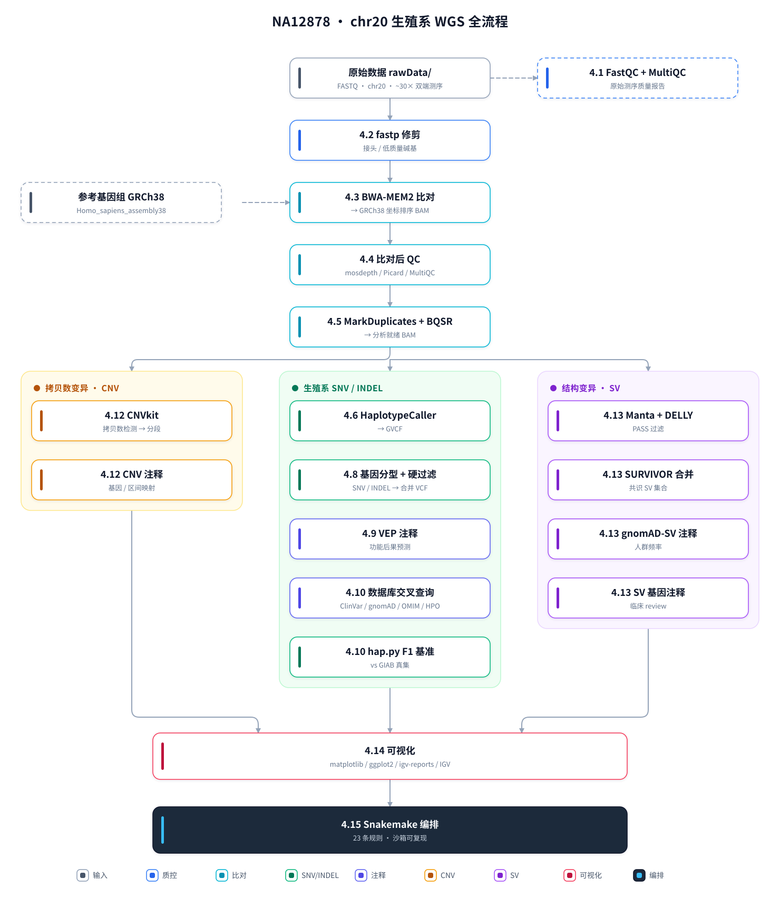

# 全基因组测序（WGS）生殖系变异分析 — 完整流程与教程

<div align="center">

   <br>
   

</div>

[English](README.md) | [简体中文](README_CN.md)

本仓库按 [Multiome Academy WGS 系列教程](https://multiomeacademy.com/tutorials/WGS/index.html)（Session 01–20）
逐节实现，是一个**完整、可复现的生殖系全基因组测序（WGS）分析流程**。
全流程以 **NA12878（HG001）第 20 号染色体** 为实践对象，比对至 **GRCh38**，
覆盖从原始 FASTQ 到变异注释、CNV、SV 及出版级图表。

---

## 流程总览



---

## 项目概要

| | |
|---|---|
| **样本** | NA12878 / HG001（NIST GIAB 标准参考材料）|
| **分析区域** | chr20（64,444,167 bp），约 30× 双端测序 |
| **参考基因组** | GRCh38（`Homo_sapiens_assembly38`）|
| **流程规模** | 13 个阶段，19 个步骤脚本，**23 条 Snakemake 规则** |
| **教程篇幅** | 6,196 行，15 节（4.1–4.15），全中文 |
| **坑记录** | 各步骤常见故障，随章节逐一说明 |
| **可复现性** | Snakemake 沙箱重跑结果与手工流程**逐项一致** |

---

## 核心结果

### 比对与质控

| 指标 | 数值 |
|---|---|
| 读段总数 | 17,037,573 |
| 比对上 | 17,032,626（**99.97%**）|
| 正确配对 | 16,908,078（99.45%）|
| 重复率 | 9.85% |
| chr20 平均深度 | **35.25×**（中位约 32×）|

### 变异调用（HaplotypeCaller + 硬过滤）

| 指标 | 数值 |
|---|---|
| **PASS 变异数** | **124,135** |
| SNV / INDEL | 103,044 / 21,091 |
| **Ts/Tv 比值** | **1.875** |
| 杂合 / 纯合 | 86,760 / 35,630 |

### 与 NIST GIAB 真集基准比对（hap.py）

| 类型 | 过滤 | Precision | Recall | **F1** |
|---|---|---|---|---|
| SNP | PASS | 0.9958 | 0.9768 | **0.9862** |
| SNP | ALL | 0.9907 | 0.9864 | 0.9886 |
| INDEL | PASS | 0.9941 | 0.9825 | **0.9883** |
| INDEL | ALL | 0.9936 | 0.9826 | 0.9881 |

### 结构变异与拷贝数变异

| 指标 | 数值 |
|---|---|
| CNV 调用 | **1 个** — `chr20:26,450,000–29,950,000`，3.5 Mb **DUP**，log2 = +0.414 |
| Manta PASS / DELLY PASS | 192 / 237 |
| SURVIVOR 共识 | **59**（55 DEL、3 DUP、1 INS）|
| 已知 / 新发（比对 gnomAD-SV v4.1）| 58 / 1 |
| 多重筛选临床候选基因 | **43** 个 |

---

## 仓库结构

```
.
├── WGS_tutorial.md        ⭐ 主教程（中文）— 15 节，6,196 行
├── SKILL.md                  可复用技能：「Snakemake 沙箱化包裹既有流水线」
├── pipeline_overview_zh.svg  流程总览图（中文，本页引用）
├── pipeline_overview_en.svg  流程总览图（英文）
│
├── scripts/               ⭐ 全部脚本
│   ├── 01–12.run_*.sh        流程步骤脚本（19 个）
│   ├── 13.config.yaml        集中配置（样本 / 工具 / 资源 / 参数）
│   ├── 13.snakefile          Snakemake 流水线（23 条规则）
│   ├── 13.run_snakemake.sh   启动器（路径校验 / dry-run / run / DAG）
│   ├── 13.verify.sh          沙箱核验 + 泄漏检测
│   ├── make_pipeline_overview.py   重新生成上方流程总览图（中 / 英）
│   └── build_git_mirror.sh   构建本占位仓库
│
├── 01.qc/ … 12.figures/   各步骤产物目录
│   └── 12.figures/           ⭐ 全部正式图表（PNG + PDF + IGV 截图）
│
├── 13.snakemake/          Snakemake 沙箱重跑产物（与 01–12 相互隔离）
│
└── rawData/               只读输入（参考基因组、GATK 资源包、数据库、VEP cache）
```

### ⚠️ 关于本仓库 —— 占位文件约定

本仓库是一个**轻量镜像**：完整工作目录为 **89 GB**，不适合放入 Git。这里保留了**完整的目录结构**，
但只有 **96 个文件是真实拷贝**，其余 **14,687 个是 0 字节占位文件**（用 `touch` 创建），
用于维持目录层级与文件名。

**有 3 个目录被整体排除**，因为它们不承载可复用信息：
`logs/`（运行日志）、`backups/`（文档快照）、`.snakemake/`（Snakemake 运行期状态，
内含机器专属的绝对路径）。

**真实拷贝的内容：**

| 类别 | 数量 | 内容 |
|---|---|---|
| 文档 | 2 | `WGS_tutorial.md`、`SKILL.md` |
| 脚本 | 41 | **全部脚本**——流程、编排、数据准备、辅助工具 |
| 图表 | 16 | 7 张图 ×（PNG + PDF）+ 2 份自包含 igv-reports HTML |
| IGV 截图 | 4 | 手工标注截图 |
| 核心结果 | 30 | 关键结果表 + 核心变异数据集（见下）|

**包含的核心结果文件**：hap.py 基准汇总、CNV 最终调用、SV 临床 review、43 候选基因表、
gnomAD 频率分层、ClinVar 分类、比对 / 重复率 / 深度 / 插入片段指标，以及最终
`filtered.vcf.gz`（124,135 条变异）、VEP 注释 VCF、SV 共识 VCF。

**这 30 个文件的用途**：教程正文内嵌了 14 张图，其中两张
（`04.post_alignment_qc/picard/..._insert_size_histogram_fixed.png` 与
`13.snakemake/rulegraph.png`）**不在 `12.figures/` 下**——若不真实拷贝，教程渲染时会出现图裂。

**最大单文件**：21.7 MB（`12.figures/NA12878_variant_report.html`），
远低于 GitHub 的 50 MB 警告线。

---

## 文档说明

| 文件 | 语言 | 内容 |
|---|---|---|
| **`WGS_tutorial.md`** | 中文 | 核心成果。15 节，逐阶段讲解概念、方法、结果与坑——含内嵌图、命令参考、参数解释表与实测数字。|
| **`SKILL.md`** | 中文 | 可复用流程：把已有脚本流水线包裹成**沙箱化 Snakemake DAG**，含 10 类常见故障的排查清单。|

### 教程章节

| 章节 | 步骤 | 对应 Session | 主题 |
|---|---|---|---|
| 第 1 章 | — | 01–03 | 简介；什么是 WGS；流程范围与能力边界 |
| 第 2 章 | 00 | 02–07 | 数据下载、环境搭建、参考基因组、GATK 资源包 |
| 第 3 章 | — | 04 | FASTQ 格式与质量 |
| **4.1** | 01 | 05 | FastQC + MultiQC |
| **4.2** | 02 | 06 | fastp 修剪 + 修剪前后对比 |
| **4.3** | 03 | 08 | BWA-MEM2 比对 |
| **4.4** | 04 | 09 | 比对后质控（mosdepth / Picard / MultiQC）|
| **4.5** | 05 | 10 | MarkDuplicates + BQSR |
| **4.6** | 06 | 11 | HaplotypeCaller |
| **4.7** | — | 12 | Joint Genotyping（*理论 — 缺 trio 数据*）|
| **4.8** | 07 | 13 | 变异过滤与 PASS 率 |
| **4.9** | 08 | 14 | VEP 注释 |
| **4.10** | 09 | 15 | 变异数据库交叉查询（ClinVar / gnomAD / OMIM / HPO）|
| **4.11** | — | 16 | Mutect2 体细胞检测（*理论 — 缺肿瘤配对样本*）|
| **4.12** | 10 | 17 | 拷贝数变异检测（CNVkit）|
| **4.13** | 11 | 18 | 结构变异检测（Manta + DELLY + SURVIVOR）|
| **4.14** | 12 | 19 | 可视化（matplotlib / ggplot2 / igv-reports / IGV）|
| **4.15** | 13 | 20 | **Snakemake 编排** |

---

## 复现方式

全流程由 Snakemake 编排，重跑结果与手工流程**完全一致**（每个产物均经 md5 / 内容比对验证）。

```bash
# 1. 校验 config 中引用的每一条路径（不写入任何文件）
bash scripts/13.run_snakemake.sh

# 2. 执行完整流程（23 条规则，可断点续跑、自动并行）
bash scripts/13.run_snakemake.sh --run

# 3. 生成 DAG 图
bash scripts/13.run_snakemake.sh --dag

# 4. 核验产物并与原流程比对 + 泄漏检测
bash scripts/13.verify.sh full          # quick | full
```

### 沙箱设计

所有产物写入 `13.snakemake/`（可通过 `config.out_root`、`--out DIR` 或环境变量
`WGS_OUT_ROOT` 指定，**优先级：CLI > 环境变量 > config**）。
**原目录 `01.qc/`–`12.figures/` 的产物与手工 IGV 截图绝不触碰**，因此重跑结果可与原结果并存比对。

### 样本参数化

样本名完全由 config 驱动，换样本无需修改任何脚本：

```yaml
# scripts/13.config.yaml
sample:        "NA12878_chr20"    # 主前缀（01–09 步产物）
sample_short:  "NA12878"          # 短前缀（CNV / SV / 图产物）
sample_label:  "NA12878 chr20"    # 展示文本（图标题）
rg_flowcell:   "HMVFKDRXX.2"      # 测序 flowcell.lane（Read Group ID 后缀）
rg_pu:         "HMVFKDRXX.2.ACGTACGT"
```

Snakefile 把这些变量传给每个步骤脚本，脚本以
`SAMPLE="${SAMPLE:-NA12878_chr20}"` 读取——**默认值即复现原有行为**。

---

## 范围与限制

本项目**不是**通用 WGS 平台，而是针对一个明确定义的分析对象：

```
NA12878（HG001）× chr20 × 约 30× 双端 × 生殖系变异
```

| 支持 | 不支持 |
|---|---|
| chr20 生殖系 WGS 全流程（SNV / INDEL / CNV / SV / 注释 / 可视化）| **切换染色体** — 需改约 30 处代码 + 重下 gnomAD AF（每染色体约 11.8 GB）|
| **更换样本名**（改 config 5 个键 + 换 FASTQ）| 全基因组变异调用（`-L chr20` 限制了调用范围）|
| 一条命令断点续跑 | Joint Genotyping / trio 分析（无 trio 数据）|
| 沙箱隔离 + 与原结果自动比对 | Mutect2 体细胞检测（无肿瘤/正常配对）|
| | 换样本后的 F1 基准 — GIAB 真集**就是** HG001 |

> ⚠️ **换样本需注意**：`09.run_happy_benchmark.sh` 使用的 GIAB 真集是 HG001（即 NA12878 本人）。
> 换成其他样本后，该步骤会给出很低的 F1——因为真集本来就属于另一个样本。替换真集或跳过该步骤。
> 应替换为该样本自己的真集，或跳过该步骤。

---

## 环境要求

- **Linux** + 共享文件系统；建议 ≥ 48 核以获得可接受的运行时间
- 隔离 conda 环境（config 全部使用绝对路径调用，因此**无需** `conda activate`）
- 完整项目约需 90 GB 磁盘（参考基因组、索引、数据库、VEP cache、产物）
- 工具链：FastQC、MultiQC、fastp、BWA-MEM2、samtools、mosdepth、GATK 4.6、VEP 105、
  SnpEff、hap.py、CNVkit、Manta、DELLY、SURVIVOR、Snakemake、matplotlib、R/ggplot2、igv-reports

> 大文件下载（参考基因组、GATK 资源包、VEP cache、gnomAD）**不由** Snakemake 流程触发——
> 它假定这些资源已存在于 `rawData/` 下。数据准备类脚本
> （`scripts/download_*.sh`、`extract_chr20_fastq.sh`、`build_bwa_mem2_index.sh`）覆盖第 00 步的搭建。

---

## 数据来源与致谢

| 资源 | 来源 |
|---|---|
| 教程结构 | [Multiome Academy WGS 系列](https://multiomeacademy.com/tutorials/WGS/index.html)（Session 01–20）|
| 样本 | NA12878 / HG001 — NIST GIAB，来自 NYGC / 1000 Genomes |
| 参考基因组 | GRCh38（`Homo_sapiens_assembly38`，Broad Institute）|
| 真集 | NIST GIAB HG001 v4.2.1 |
| 变异数据库 | ClinVar（NCBI）、gnomAD v4.1、DGV、OMIM、HPO |
